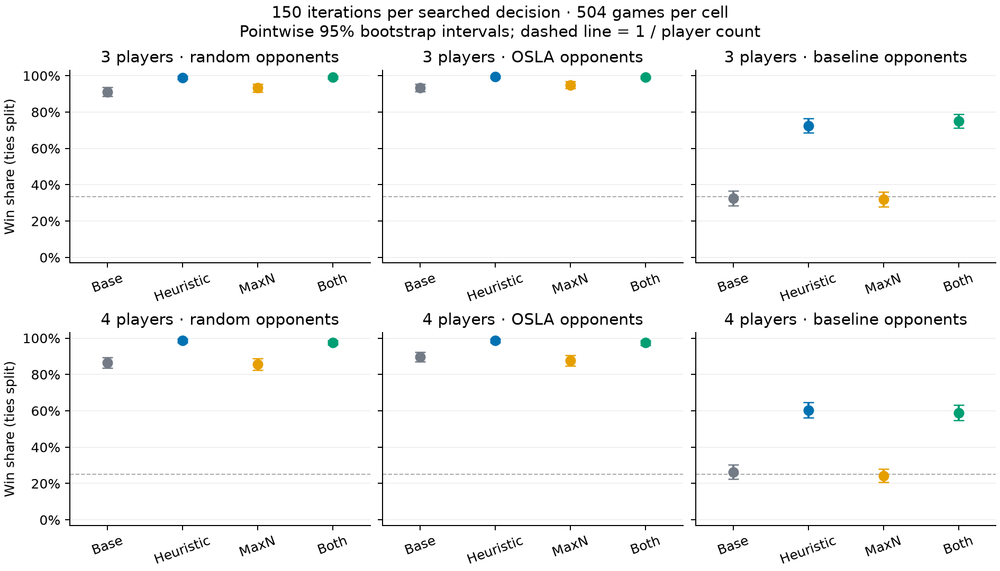
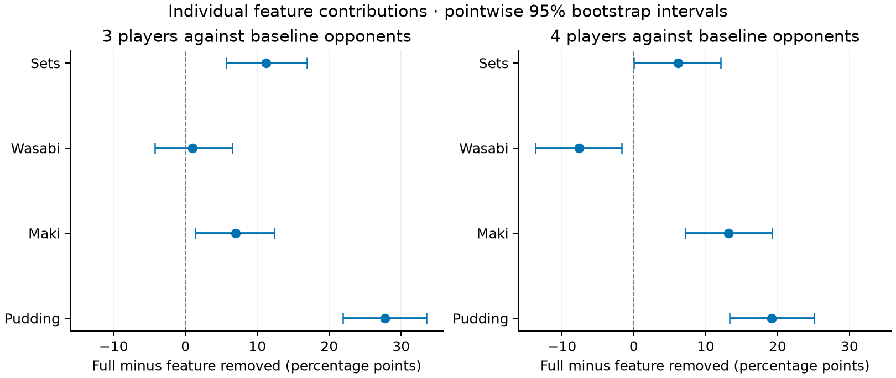
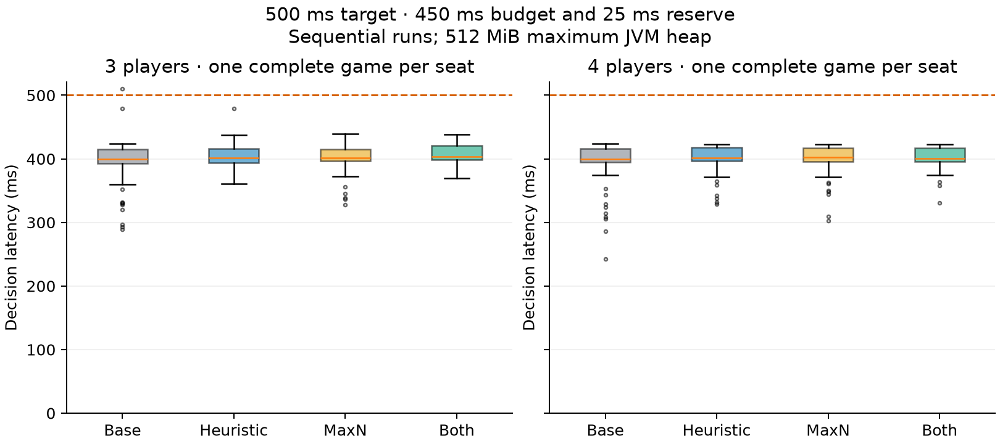

# Stage 5 results

Validated 16,128 fixed-iteration games across 32 cells (504 games per cell). Each cell has equal numbers in every seat.

Each game has one focal agent and opponents of the same type in the other seats. These comparisons use multiplayer lineups. Win share is 1 for a sole winner, 1/k for each of k tied winners after TAG's Pudding tiebreak, and 0 otherwise.

Pointwise 95% percentile intervals use 5,000 bootstrap resamples within each seat. Cells have independent seed streams, and contrasts use independent bootstrap draws. The intervals are exploratory and unadjusted for multiple comparisons. Shared controls make some contrasts correlated, so the analysis makes no significance claim for the whole family of tests. If all sampled outcomes are identical, the interval has zero width; the population rate can still be uncertain.

## Main comparisons

[Vector PDF](main-comparisons.pdf). Base is the corrected baseline, Heuristic adds the custom evaluation, MaxN changes opponent selection, and Both combines the changes. The dashed 1/n line shows the reference for equal players. Expected win share differs against stronger or weaker opponents.

| Players | Opponents | Variant | Win share (95% CI) | Mean score |
|---:|---|---|---:|---:|
| 3 | random | baseline | 91.2% (88.7%–93.6%) | 46.13 |
| 3 | random | heuristic | 99.0% (98.0%–99.8%) | 51.75 |
| 3 | random | multiplayer | 93.4% (91.1%–95.4%) | 46.27 |
| 3 | random | combined | 99.1% (98.2%–99.8%) | 51.75 |
| 3 | osla | baseline | 93.5% (91.3%–95.4%) | 46.02 |
| 3 | osla | heuristic | 99.4% (98.6%–100.0%) | 52.31 |
| 3 | osla | multiplayer | 94.9% (93.1%–96.8%) | 45.92 |
| 3 | osla | combined | 99.1% (98.2%–99.8%) | 52.28 |
| 3 | baseline | baseline | 32.6% (28.4%–36.7%) | 39.76 |
| 3 | baseline | heuristic | 72.5% (68.6%–76.4%) | 46.87 |
| 3 | baseline | multiplayer | 31.9% (28.0%–36.0%) | 39.89 |
| 3 | baseline | combined | 75.1% (71.2%–78.8%) | 46.37 |
| 4 | random | baseline | 86.6% (83.5%–89.5%) | 38.67 |
| 4 | random | heuristic | 98.6% (97.4%–99.6%) | 44.54 |
| 4 | random | multiplayer | 85.7% (82.5%–88.7%) | 38.82 |
| 4 | random | combined | 97.6% (96.2%–98.8%) | 44.56 |
| 4 | osla | baseline | 89.7% (87.0%–92.3%) | 38.97 |
| 4 | osla | heuristic | 98.7% (97.6%–99.6%) | 44.57 |
| 4 | osla | multiplayer | 87.7% (84.7%–90.5%) | 38.92 |
| 4 | osla | combined | 97.4% (96.0%–98.8%) | 44.45 |
| 4 | baseline | baseline | 26.4% (22.5%–30.4%) | 31.83 |
| 4 | baseline | heuristic | 60.4% (56.2%–64.7%) | 38.24 |
| 4 | baseline | multiplayer | 24.3% (20.6%–28.1%) | 31.69 |
| 4 | baseline | combined | 58.9% (54.7%–63.2%) | 38.39 |

## Combined versus corrected baseline

| Players | Opponents | Difference in win share | Pointwise 95% CI |
|---:|---|---:|---:|
| 3 | random | +7.94 pp | +5.36 to +10.52 pp |
| 3 | osla | +5.65 pp | +3.47 to +8.04 pp |
| 3 | baseline | +42.46 pp | +36.71 to +48.02 pp |
| 4 | random | +11.01 pp | +7.84 to +14.29 pp |
| 4 | osla | +7.74 pp | +4.86 to +10.71 pp |
| 4 | baseline | +32.54 pp | +26.79 to +38.39 pp |

[contrasts.csv](contrasts.csv) contains every conditional effect and the factorial interaction.

## Feature removals

A positive full-minus-removed difference favours keeping the feature. An interval crossing zero leaves the direction unresolved. Each main-study condition has 504 games against baseline opponents. All removals keep MAXN and the other weights at 1.0, so other feature interactions remain untested.

[Vector PDF](feature-ablations.pdf) · [Exact estimates](feature-effects.csv)

| Players | Feature | Full minus removed | Pointwise 95% CI |
|---:|---|---:|---:|
| 3 | sets | +11.21 pp | +5.65 to +16.87 pp |
| 3 | wasabi | +0.99 pp | -4.27 to +6.55 pp |
| 3 | maki | +6.94 pp | +1.39 to +12.40 pp |
| 3 | pudding | +27.78 pp | +21.92 to +33.53 pp |
| 4 | sets | +6.15 pp | +0.00 to +12.10 pp |
| 4 | wasabi | -7.64 pp | -13.69 to -1.68 pp |
| 4 | maki | +13.19 pp | +7.14 to +19.25 pp |
| 4 | pudding | +19.15 pp | +13.29 to +25.10 pp |

## Timing study

The sequential timing study contains 28 complete games and 633 searched decisions. Decisions exceeding 500 ms: 1. The largest was 509.870 ms.

| Players | Variant | Decisions | Median ms | P95 ms | Max ms | Over 500 ms |
|---:|---|---:|---:|---:|---:|---:|
| 3 | baseline | 75 | 399.55 | 423.65 | 509.87 | 1 |
| 3 | heuristic | 72 | 401.74 | 423.42 | 478.75 | 0 |
| 3 | multiplayer | 72 | 401.14 | 423.30 | 439.17 | 0 |
| 3 | combined | 75 | 403.83 | 423.83 | 438.34 | 0 |
| 4 | baseline | 85 | 399.86 | 422.87 | 423.38 | 0 |
| 4 | heuristic | 85 | 401.42 | 422.43 | 423.24 | 0 |
| 4 | multiplayer | 85 | 402.21 | 422.69 | 423.07 | 0 |
| 4 | combined | 84 | 400.78 | 422.75 | 423.11 | 0 |

[Vector PDF](decision-timing.pdf) · [Exact timing summaries](timing-summary.csv)

The measurements cover searched decisions in all three rounds and Chopsticks when encountered. They exclude external observation and action-list generation, logging and forced single-action turns. The configuration uses 450 ms with a 25 ms reserve; warmups and measured games use a 128-512 MiB JVM heap. This small sample describes observed latency. It cannot establish playing strength at 500 ms or guarantee that every decision meets the deadline.

## Replication and limits

The manifest records the TAG revision, source and configuration hashes, machine, runtime and seed policy. Snapshots preserve the sources and settings used with the raw data. Equal iteration counts do not equalise elapsed time: MaxN evaluates more players per leaf. Recorded seeds also cannot reproduce every hidden-state sample in TAG. The results apply to the tested opponents and budgets; they do not rank all agents or establish optimality.

Weights were fixed before the study. A configuration chosen from these results should be checked on new games before making a final strength claim.
